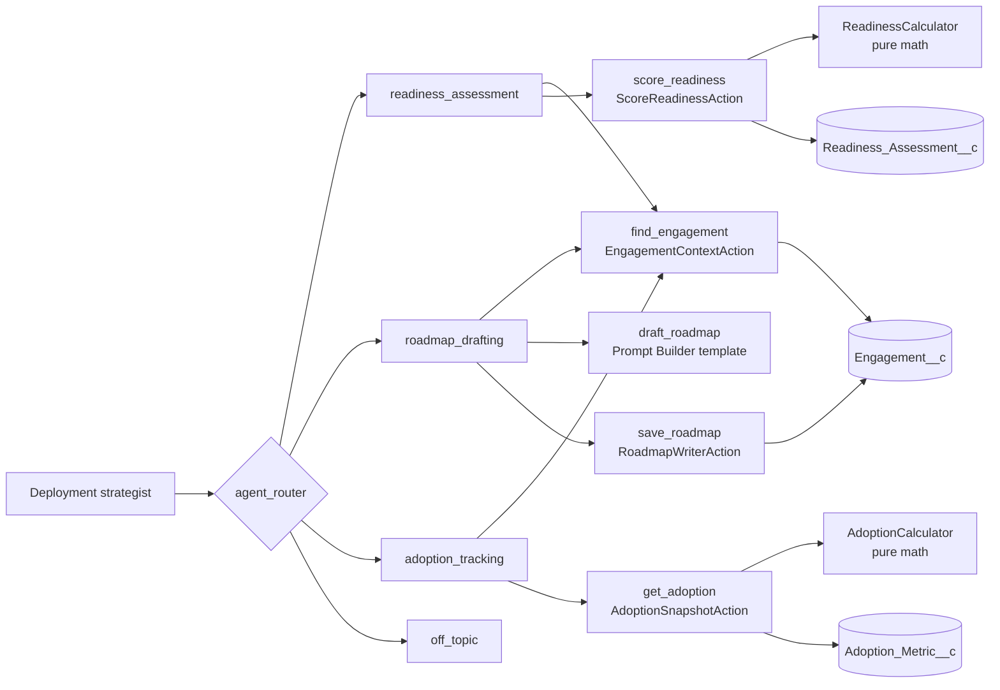

# Architecture

## The shape

One employee agent, four subagents, four Apex actions, one prompt template, three custom objects.

## Data model

| Object | Purpose | Key fields |
|---|---|---|
| `Engagement__c` | One time-boxed customer engagement | Account, Stage (Identify, Commit, Deploy, Consume), Status, start and end dates, Readiness Score, Roadmap, Roadmap Approved On |
| `Readiness_Assessment__c` | One scored assessment | Six 1 to 5 ratings, Total Score, Band, Gaps |
| `Adoption_Metric__c` | One week of numbers | Week Ending, Eligible Users, Active Users, Conversations, Resolved By Agent, Credits Consumed |

Two derived numbers matter. Adoption rate is active users divided by eligible users. Containment rate is conversations the agent resolved divided by total conversations.

## Readiness scoring

Six dimensions, each rated 1 to 5 by the user:

| Dimension | Weight |
|---|---|
| Data readiness | 20 |
| Use case clarity | 20 |
| Executive sponsorship | 15 |
| Responsible AI governance | 15 |
| Platform readiness | 15 |
| Change readiness | 15 |

Total = sum of (rating / 5 x weight), 0 to 100.

| Total | Band |
|---|---|
| 85 and up | Ready |
| 70 to 84.9 | Ready with conditions |
| 50 to 69.9 | Foundational work needed |
| Below 50 | Not ready |

**Blocked overrides the table.** A rating of 1 on executive sponsorship or on responsible AI governance returns Blocked, even if everything else is a 5. A high average can hide a project with nobody paying for it. The unit tests cover this case by name.

## Adoption risk

| Flag | Rule |
|---|---|
| Low adoption | Adoption rate under 40% at week 6 or later |
| Falling adoption | Down more than 5 points since last week |
| Low containment | Agent resolved under 50% of conversations |
| Falling containment | Down more than 10 points since last week |

Zero flags is Low, one is Medium, two or more is High. No data at all returns Unknown. An empty dataset tells you nothing, so it never scores as Low.

These thresholds are heuristics I picked for a 12-week engagement. Tune them per customer.

## Why it's built this way

**Apex does the math, the agent does the talking.** Language models are unreliable at arithmetic and don't reproduce the same answer twice. A calculator class gives the same output every run, and I can unit test it.

**Name lookup is an action.** The user says "Fernhollow." The agent can't be trusted to produce a record ID from that, so `EngagementContextAction` resolves it. If two engagements match, it returns names and the agent asks which one.

**The prompt template is the only place the model writes freely.** A roadmap needs language generation. Scores and metrics don't. The template gets one text block of facts assembled by Apex and is told to write "unknown" for anything missing.

**Approval is checked twice, and the second check is code.** The agent's instructions say to ask first. `RoadmapWriterAction` also refuses to write unless `approvedByUser` is true. And the text it writes comes from a variable, not from the model's rewording of the draft, so the user approves the exact text that gets saved.

**Employee agent, not service agent.** The user is an internal strategist. An employee agent runs as the signed-in user, so record access follows their permissions without a separate service user.

**Everything runs in user mode.** SOQL uses `WITH USER_MODE` and DML uses `as user`, so field-level security and object permissions apply to the agent the same way they apply to the person.

## Responsible AI checklist

| Risk | Control | Where it's tested |
|---|---|---|
| Made-up numbers | Numbers come from actions only. Instructions forbid estimating. | "Just ballpark..." test case |
| Unapproved writes | Code refuses without approval | `RoadmapWriterActionTest`, "Save the roadmap..." test case |
| Prompt injection through record text | System instructions treat records as data | "Ignore your instructions..." test case |
| Out-of-scope requests | `off_topic` subagent declines | Sourdough test case |
| Invalid inputs | Validation in Apex, agent asks again | `ReadinessCalculatorTest`, sponsorship-of-7 test case |
| Over-broad access | User mode, permission set, no delete permission | Permission set metadata |

## What's not here yet

- **Data 360.** Adoption numbers sit in a custom object. The next step is streaming them into Data 360, building the adoption rate as a calculated insight, and grounding the agent on it. See the stretch milestone in [BUILD_GUIDE.md](BUILD_GUIDE.md).
- **Conversation logging.** Agent session traces are available through the CLI (`sf agent trace`). A reporting layer on top of them isn't built.
- **A UI.** Everything runs through the agent. There are no Lightning pages.
